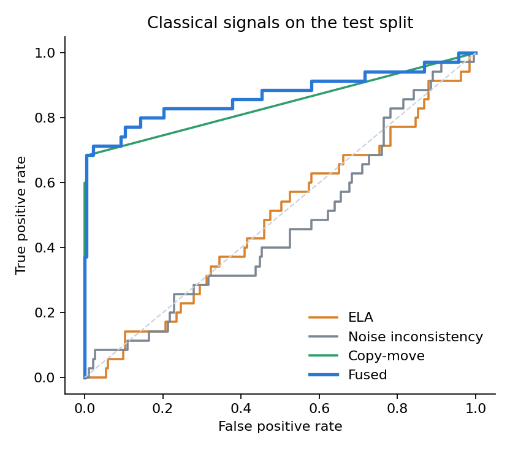
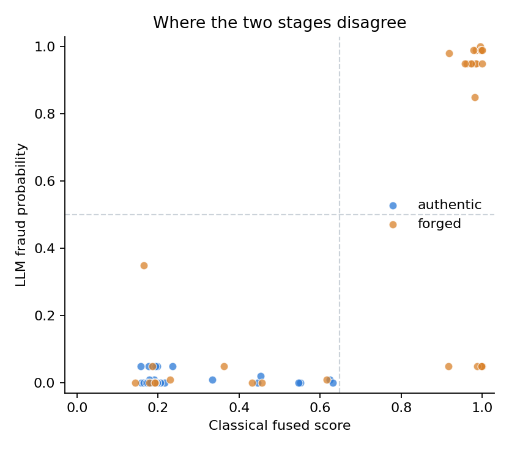
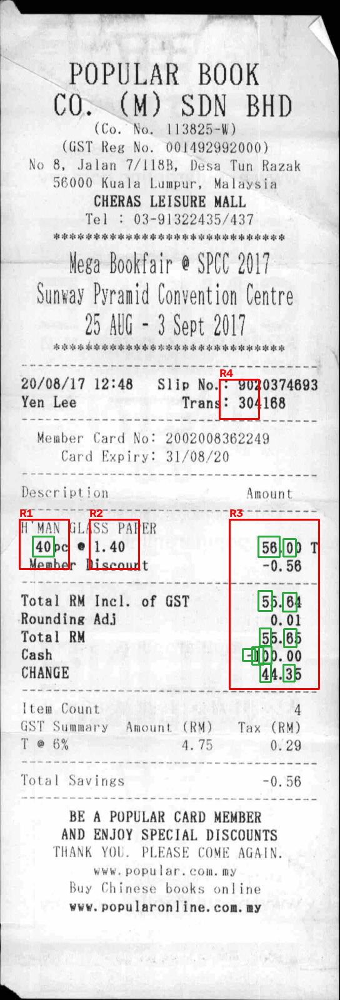
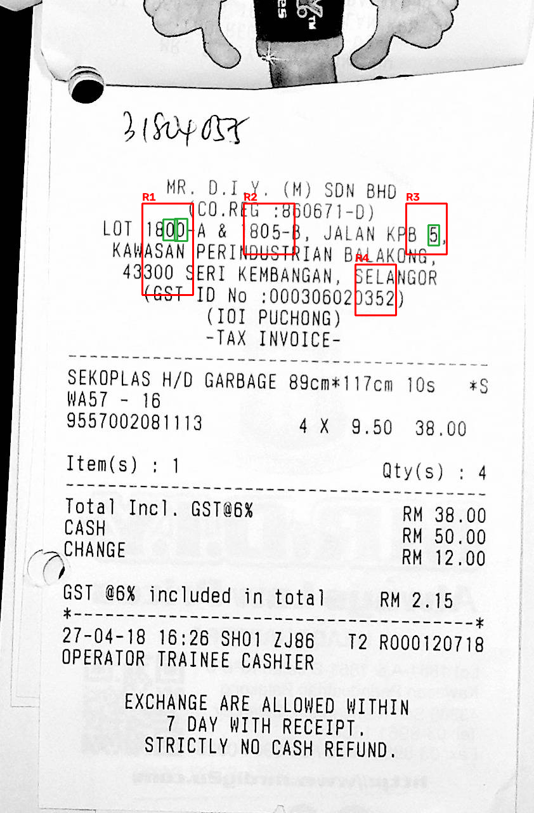
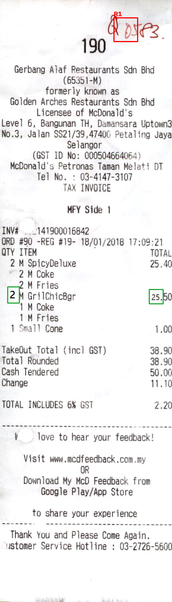

# Document tampering detector: pixel forensics + LLM reasoning

Detects edited receipts in two stages and measures where the stages disagree.

1. **Classical forensics (OpenCV).** Error level analysis, noise inconsistency and copy-move detection turn a scan into heat maps and a ranked list of suspicious rectangles. No training data is needed for the signals themselves.
2. **LLM review (Gemini or Claude).** A vision model looks at each flagged rectangle next to its forensic evidence, can zoom anywhere on the page at native resolution, and decides whether the oddity is an edit that changes what the document says or something harmless such as a handwritten note, a stamp or scanner noise. It returns a structured verdict with a per-region explanation.

A classifier alone gives a fraud team a score. This gives them a location, a reason, and a second opinion that reads the document the way a person would.

## Dataset

[Find it again!](https://l3i-share.univ-lr.fr/2023Finditagain/index.html) (Martínez Tornés et al., ICDAR 2023): 988 scanned receipts from SROIE, 163 of them forged by people using image editors, with rectangles marking the altered areas and the technique used. Many authentic receipts carry handwritten or digital notes that are explicitly *not* forgeries, which is exactly the distinction stage 2 exists for. One validation image is listed but missing from the archive, so 987 are used.

```bash
mkdir -p data/raw
curl -L -o data/raw/findit2.zip https://l3i-share.univ-lr.fr/2023Finditagain/findit2.zip
python -c "import zipfile; z=zipfile.ZipFile('data/raw/findit2.zip'); z.extractall('data', [n for n in z.namelist() if n.startswith('findit2/')])"
```

## Run

```bash
python -m venv .venv && .venv/Scripts/pip install -r requirements.txt   # Windows; use .venv/bin/pip elsewhere
python scripts/run_classical.py     # forensics on all images -> results/classical.json  (about 10 min)
python scripts/evaluate.py          # benchmark -> results/report.md + results/figures/
```

LLM stage (needs `GEMINI_API_KEY`, free from [AI Studio](https://aistudio.google.com/apikey), or `ANTHROPIC_API_KEY` in `.env`; see `.env.example`):

```bash
python scripts/run_llm.py --dry-run   # no API calls; saves what the model would see to results/debug/llm_input/
python scripts/run_llm.py --limit 6   # small smoke test
python scripts/run_llm.py             # all 35 forged test receipts + 35 authentic
python scripts/evaluate.py            # rerun: adds the classical-vs-LLM and disagreement sections
```

Verdicts are cached per image in `results/cache/llm-<provider>-<model>/`, so a rerun only sends new images. If the free tier's daily cap is reached the run stops cleanly and can be resumed the next day.

## Results: classical stage (held-out test split)

The fusion model is fitted on train, its threshold is chosen on val, and the numbers are from the 218 test receipts (35 forged).

| Signal | ROC AUC | 95% CI |
|---|---|---|
| ELA | 0.49 | 0.38 to 0.59 |
| Noise inconsistency | 0.47 | 0.36 to 0.57 |
| Copy-move | 0.84 | 0.76 to 0.92 |
| Fused (logistic regression) | 0.87 | 0.77 to 0.95 |

At the validation-chosen threshold the fused detector has precision 0.92, recall 0.69, F1 0.79, and flags 2 of 183 authentic receipts. A top-5 proposed region lands on an annotated altered area for 28 of 35 forged receipts.

What the numbers say:

- **Copy-move does nearly all the work.** Most forgeries here (27 of 35) copy digits from elsewhere on the same receipt. A pasted digit is identical to its source pixel for pixel, while two genuinely printed copies of the same digit differ by scan noise. The detector hashes every 8x8 block at native resolution and keeps exact duplicates that move together. It localises 26 of those 27 receipts.
- **ELA and noise are at chance on this dataset.** The forged files were saved as PNG after editing and the edits are often a single character, so there is no JPEG history to compare and too few pixels for a noise estimate. They are kept because they still propose regions for the LLM, and because they are the signals that matter on JPEG-native documents.
- **The misses are the interesting part.** Retyped text (IMI), erased fields (CUT) and content pasted from another document (CPO) leave no duplicate on the page: 7 forged receipts get no useful region at all. Those are the cases where reading the document (does the total add up, does this glyph match its neighbours) has to do what pixels cannot.



Full tables, per-technique recall, ROC curves and overlay images are in `results/report.md`.

## Results: classical versus LLM

The LLM reviewed 70 test receipts (all 35 forged plus 35 authentic) using `gemini-3.5-flash-lite` on Google's free tier, one request per receipt, no zoom. All rows are on that same subset.

| Method | ROC AUC | 95% CI | Precision | Recall | F1 |
|---|---|---|---|---|---|
| Classical fused | 0.85 | 0.74 to 0.95 | 1.00 | 0.69 | 0.81 |
| LLM review, prompt v2 | 0.86 | 0.76 to 0.94 | 1.00 | 0.54 | 0.70 |
| LLM review, prompt v1 | 0.70 | 0.59 to 0.81 | 1.00 | 0.14 | 0.25 |

Agreement between the classical stage and the LLM (prompt v2):

| Ground truth | Both right | Only classical right | Only LLM right | Both wrong |
|---|---|---|---|---|
| Forged (35) | 19 | 5 | 0 | 11 |
| Authentic (35) | 35 | 0 | 0 | 0 |



Each dot is a receipt. Bottom right holds the forgeries the pixels caught and the LLM cleared; top right holds the ones both caught.

How the LLM (prompt v2) read each region the classical stage flagged:

| Flagged region is | content edit | benign annotation | print or scan artifact | nothing unusual |
|---|---|---|---|---|
| on an altered area (54) | 37 | 0 | 13 | 4 |
| not on an altered area (45) | 4 | 4 | 34 | 3 |

What this shows:

- **The first prompt let the LLM talk itself out of real evidence.** Under v1 it dismissed 47 of 54 regions sitting on a genuine edit, with explanations like "false positives triggered by repeating font glyphs", and caught 5 of 35 forgeries. A pasted digit looks normal, and the model trusted its eyes over the forensic signal.
- **Telling it what the signal physically means fixed most of that.** Prompt v2 explains that printing and scanning never produce pixel-identical glyphs, that a pasted digit is supposed to look normal, and restates this beside each copy-move crop. Confirmed true flags rose from 7 to 37 of 54 and recall from 0.14 to 0.54, with no authentic receipt accused. The wording was developed on 20 validation receipts and then run once on the test subset.
- **The LLM still never beats the pixels.** There is no receipt where the LLM was right and the classical stage wrong. In 5 forged receipts it still cleared a document the pixels had caught.
- **It filters false flags well, at a small cost.** 41 of 45 regions that were not on an altered area were dismissed. The 4 it endorsed were all on receipts that are forged elsewhere, so no authentic receipt was accused, but v2 is more willing to confirm a flag than v1 was (v1 endorsed none).
- **Reading the document did not rescue the misses.** The 11 forgeries the pixels missed (retyped text, erasures, outside pastes) were also passed by the LLM under both prompts, typically with a note that the arithmetic is consistent. A competent forger keeps the totals consistent.

The practical reading: on this data the LLM's value is the explanation and the per-region triage, not extra detection. Its verdict is best used alongside the classical score, not in place of it.

Caveats: Flash-Lite is the smallest model in its family, it ran without the zoom tool, and the free tier's 20-requests-per-day cap on the larger Flash models is what forced both choices. This does not say what a stronger model with zoom would do. The Claude path (`tamper/llm.py`, multi-turn with zoom) is implemented but has not been run against the API. `TAMPER_PROMPT=v1` reproduces the first prompt.

The individual disagreement cases, with the model's explanation and an overlay for each, are in `results/report.md`.

## Examples

Red boxes are regions the classical stage flagged; green boxes are the annotated altered areas.

| Caught by both | Caught by pixels, cleared by the LLM | Missed by both |
|---|---|---|
|  |  |  |
| Copy-pasted digits; duplicate-block detection lands on them. | The flag is on the edit, but the LLM judged the page authentic. | Retyped text leaves no duplicate on the page and reads as consistent. |

## How it works

`tamper/forensics.py`
- **ELA**: recompress at JPEG quality 90, take the per-block error, divide by local edge energy (otherwise every bold headline lights up), and z-score against the other inked blocks on the page.
- **Noise**: median-filter residual on flat pixels per block, z-scored against the page. Both too clean and too noisy count.
- **Copy-move**: exact duplicate 8x8 blocks found by hashing, restricted to blocks with anti-aliased ink edges (flat paper and pure black repeat by chance), grouped by displacement vector, and kept only when at least 6 neighbouring blocks share one vector.
- **Regions**: each map is thresholded, merged into connected components, and ranked; a component scores higher when independent signals agree.

`tamper/llm.py`
- Sends the page with regions outlined, then for each region a native-resolution crop beside its ELA heat map, with the signals that fired and the evidence score.
- One tool, `zoom`, returns any rectangle at native resolution. The page image is downscaled, so this is how the model reads small print or compares glyph shapes, and how it can check fields the pipeline did not flag.
- The final answer is constrained to a JSON schema: an assessment for each region (`content_edit`, `benign_annotation`, `print_or_scan_artifact`, `nothing_unusual`) with an explanation, any unflagged findings with coordinates, a summary, a fraud probability and a verdict.
- `tamper/llm_gemini.py` is the Gemini version: same evidence, prompt and schema, defaulting to one request per receipt on `gemini-3.5-flash-lite` because of free-tier quotas (`TAMPER_ZOOM=1` enables the zoom loop).
- The Claude version uses `claude-opus-5-5` with adaptive thinking. Server-side refusal fallbacks are on, so a request declined by a safety classifier is rerouted to another model rather than dropped; the model that answered is recorded with each verdict. Override with `TAMPER_MODEL` and `TAMPER_EFFORT`.

`tamper/dataset.py` parses the annotation files. Rectangles marked as the *source* of a copy are kept apart from altered areas; a region proposal touching either counts as localised, since the detector cannot tell which copy came first.

## Limits

- One dataset, one document type, 35 forged test images. The confidence intervals are wide and the copy-move result depends on forgers pasting without resampling; a resized, rotated or JPEG-resaved paste would defeat exact matching.
- The fusion threshold and the region thresholds in `forensics.py` were set while looking at train-split samples only.
- The LLM subset is class-balanced, so its precision is not comparable with full-test precision. The report compares both methods on the same subset.
