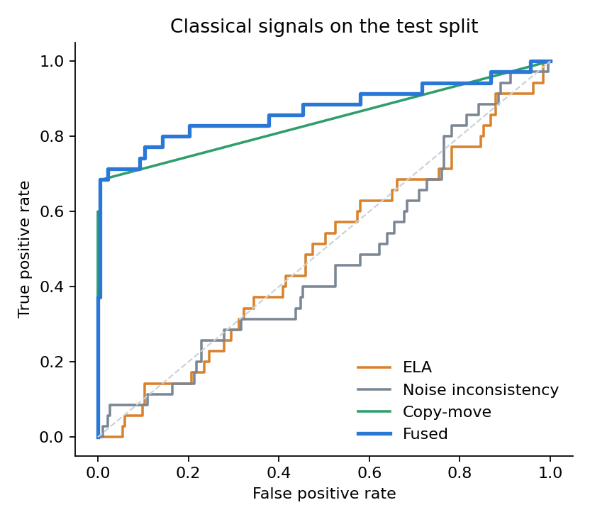
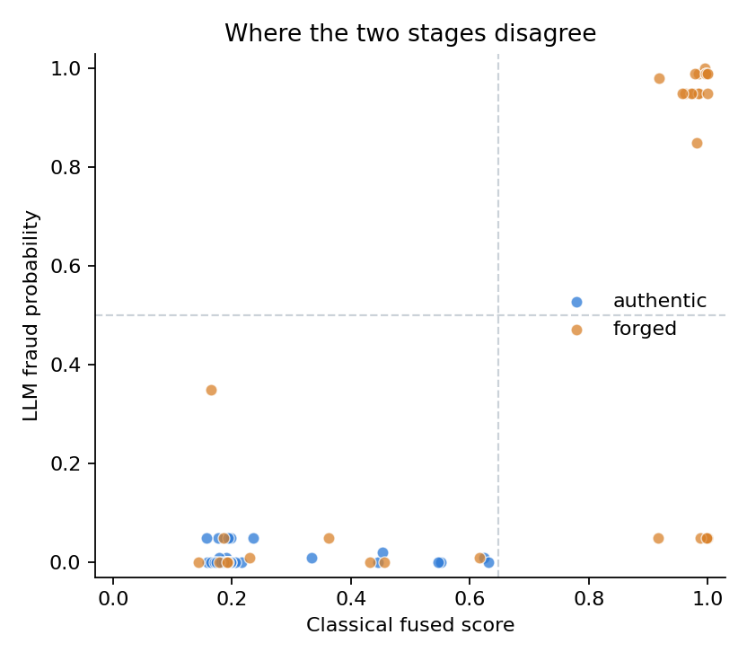

# Benchmark report

Dataset: Find it again! (L3i, ICDAR 2023). Test split: 218 receipts, 35 forged. Fusion fitted on train (577), threshold chosen on val (192).

## Classical signals, image level

| Signal | ROC AUC | 95% CI | Precision | Recall | F1 |
|---|---|---|---|---|---|
| ELA | 0.487 | 0.38 to 0.59 |  |  |  |
| Noise inconsistency | 0.466 | 0.36 to 0.57 |  |  |  |
| Copy-move | 0.841 | 0.76 to 0.92 |  |  |  |
| **Fused (logistic)** | 0.869 | 0.77 to 0.95 | 0.92 | 0.69 | 0.79 |

AUC intervals are bootstrap percentiles over the test images. Precision, recall and F1 use the validation-chosen threshold.

## Where the classical stage works and where it does not

Localisation: on 28 of 35 forged test receipts, at least one of the top-5 proposed regions touches an annotated altered area or its copy source.

| Forgery technique | Forged receipts | Detected | Localised |
|---|---|---|---|
| CPI (copy-paste inside) | 27 | 22 (81%) | 26 (96%) |
| CUT (cut / erase) | 5 | 2 (40%) | 3 (60%) |
| IMI (imitation (retyped)) | 3 | 1 (33%) | 1 (33%) |
| PIX (pixel edit) | 3 | 1 (33%) | 2 (67%) |
| CPO (copy-paste outside) | 2 | 0 (0%) | 0 (0%) |

A receipt with several techniques is counted under each.

False alarms on authentic receipts, by the benign marks they carry:

| Authentic receipts with | Count | Flagged as forged |
|---|---|---|
| no annotation | 88 | 1 (1%) |
| handwritten annotation | 91 | 1 (1%) |
| digital annotation | 11 | 0 (0%) |

## Classical versus LLM

Subset reviewed by the LLM (gemini-3.5-flash-lite): 70 test receipts, 35 forged. Class balance here differs from the full test split, so precision is not comparable with the table above; both rows below are on this same subset.

| Method | ROC AUC | 95% CI | Precision | Recall | F1 | Accuracy |
|---|---|---|---|---|---|---|
| Classical fused | 0.850 | 0.74 to 0.95 | 1.00 | 0.69 | 0.81 | 0.84 |
| LLM review (prompt v2) | 0.856 | 0.76 to 0.94 | 1.00 | 0.54 | 0.70 | 0.77 |
| LLM review (prompt v1) | 0.704 | 0.59 to 0.81 | 1.00 | 0.14 | 0.25 | 0.57 |

### Agreement

| Ground truth | both right | only classical right | only LLM right | both wrong |
|---|---|---|---|---|
| forged | 19 | 5 | 0 | 11 |
| authentic | 35 | 0 | 0 | 0 |

Top-left and bottom-right quadrants are the disagreements; colour is the ground truth.

### Region level: how the LLM read the classical flags

| Flagged region is | content_edit | benign_annotation | print_or_scan_artifact | nothing_unusual |
|---|---|---|---|---|
| on an altered area | 37 | 0 | 13 | 4 |
| not on an altered area | 4 | 4 | 34 | 3 |

First row, `content_edit` is the LLM confirming a true flag; the other columns are true flags it explained away. Second row, `content_edit` is the LLM endorsing a false flag; the other columns are false flags it correctly dismissed.

### Disagreement cases

**Forged, caught by pixels, cleared by the LLM** (5)

- `X51005568866.png` (techniques: CPI; classical 1.00, LLM 0.05) [overlay](figures/case_X51005568866.png). LLM: The receipt displays standard thermal print characteristics and consistent alignment across all line items and totals. The forensic copy-move signals are false positives driven by repeating characters and standard receipt formatting rather than actual image tampering.
- `X51007103688.png` (techniques: CPI; classical 1.00, LLM 0.05) [overlay](figures/case_X51007103688.png). LLM: The receipt exhibits routine copy-move forensic flags across the standard corporate address header, which are common false positives caused by repeating characters in printed text. All totals, item descriptions, and transaction details are internally consistent and show no signs of digital alteration.
- `X51007231361.png` (techniques: CUT; classical 0.92, LLM 0.05) [overlay](figures/case_X51007231361.png). LLM: The receipt shows consistent typography, properly aligned text, and correct mathematical totals across all sections. The forensic signals triggered are typical artifacts from scanning thermal paper and logos rather than actual image edits.
- `X51007579714.png` (techniques: CPI; classical 0.99, LLM 0.05) [overlay](figures/case_X51007579714.png). LLM: The receipt shows typical thermal print characteristics and scanning artifacts. Although the forensic pipeline flagged regions due to repeating patterns in standard text, no visual evidence of content modification or forgery was found.

**Forged, missed by both** (11)

- `X51005230616.png` (techniques: IMI; classical 0.14, LLM 0.00) [overlay](figures/case_X51005230616.png). LLM: The flagged region contains a handwritten red ink note at the top, which commonly triggers error level analysis due to ink differences. No signs of digital manipulation or text tampering are present on the receipt content.
- `X51005433556.png` (techniques: CPI; classical 0.36, LLM 0.05) [overlay](figures/case_X51005433556.png). LLM: The receipt shows typical thermal print characteristics with no evidence of digital tampering or copy-paste edits. All flagged regions are false positives driven by text density and scan noise.
- `X51005442361.png` (techniques: CPI; classical 0.23, LLM 0.01) [overlay](figures/case_X51005442361.png). LLM: The receipt shows normal print quality and alignment across all line items, totals, and identifying details. The single flagged region is a false positive caused by normal scan noise around standard text.
- `X51005705729.png` (techniques: CUT, PIX; classical 0.19, LLM 0.00) [overlay](figures/case_X51005705729.png). LLM: The receipt shows normal thermal printing characteristics and consistent text alignment throughout. There are no signs of copy-paste forgeries, font substitutions, or numerical discrepancies in the line items and totals.

Overlays: red boxes are classical proposals, green boxes are ground-truth altered areas.

## Example overlays

- Highest-scoring forged: `X51005568866.png`, score 1.00, techniques CPI. [overlay](figures/example_X51005568866.png)
- Highest-scoring authentic (false alarm): `X51006913019.png`, score 0.99, techniques none. [overlay](figures/example_X51006913019.png)
- Lowest-scoring forged (miss): `X51005230616.png`, score 0.14, techniques IMI. [overlay](figures/example_X51005230616.png)

Fusion threshold (from val): 0.648. Fusion coefficients (standardised): ela_max -0.29, ela_p99 +0.14, noise_max +0.38, noise_p99 -0.17, copymove_blocks +1.44, copymove_clusters +0.64, n_regions +0.51.
